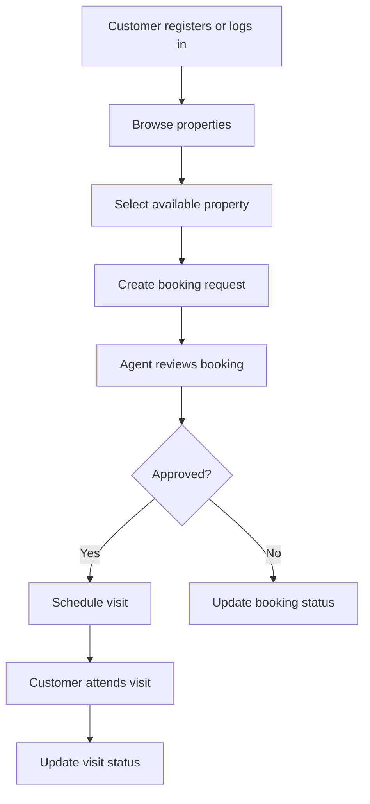
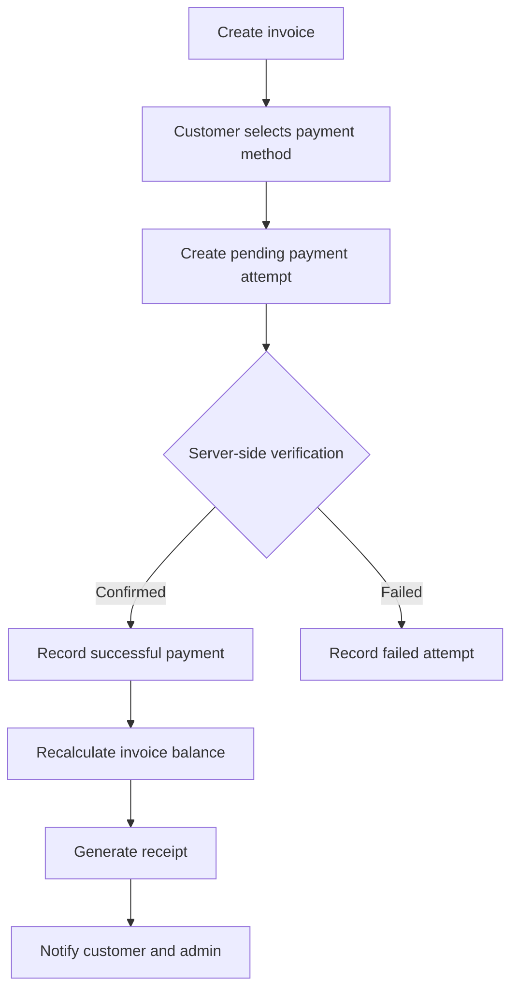

<div align="center">

# 🏢 EstateFlow
### Complete Real Estate Management System

**Property discovery · Customer visits · Bookings · Rentals · Sales · Payment tracking**

   

**Developer:** Nelamoni · **Trainee ID:** 1297020  
**Program:** Is-DB-BISEW · **TSP:** U.S Software Limited  
**Course:** Web Application Development · **Batch:** PWAD/USSL-M/73/01

[GitHub Repository](https://github.com/nelamonirn-dotcom/Real_Estate_Management_System_project)

</div>

> **Project status:** This README documents the **proposed system**, not a verified completed implementation. Features, commands, routes, and database structures are plans until implemented. Prepared from `PROJECT_PROPOSAL.pdf` (9 pages; proposal date: 03 November 2026).

## 📑 Contents

1. [Introduction](#-introduction)
2. [Problem and objectives](#-problem-and-objectives)
3. [Who benefits](#-who-benefits)
4. [Features and delivery phases](#-features-and-delivery-phases)
5. [Homepage and user journeys](#-homepage-and-user-journeys)
6. [Technology and architecture](#-technology-and-architecture)
7. [Database ER diagram](#-database-er-diagram)
8. [Database tables and relationships](#-database-tables-and-relationships)
9. [Payment management](#-payment-management)
10. [Suggested project structure](#-suggested-project-structure)
11. [Development setup](#-development-setup)
12. [30-day development plan](#-30-day-development-plan)
13. [Security and testing](#-security-and-testing)
14. [Deployment and future scope](#-deployment-and-future-scope)
15. [Source notes and open decisions](#-source-notes-and-open-decisions)

## 🌟 Introduction

EstateFlow is a **proposed web-based real estate management system** that unifies property listings, customer inquiries, property visits, bookings, rental agreements, sales records, payments and administrative operations. It combines a public property discovery website with restricted dashboards for authorized users.

**Vision:** Make property discovery, booking, rental operations and financial tracking simpler, clearer and more reliable through one integrated web platform.

## 🎯 Problem and objectives

Traditional property operations often depend on paper records, spreadsheets, calls and messaging apps. This can cause stale listings, missed follow-ups, delayed rent updates and weak audit trails.

**Primary objective:** Build a maintainable, secure, responsive, role-based web application for everyday real estate workflows.

**Specific objectives:**
- Centralize property and customer information.
- Enable registration, authentication and role-based permissions.
- Publish listings with photos, prices, locations and availability.
- Provide search, filters, inquiries, visits and bookings.
- Track rental agreements, dues, payment records and maintenance.
- Offer operational dashboards and reports.
- Use a relational MySQL model with enforceable integrity rules.

**Scope boundary:** EstateFlow is not a land registry, automated legal title-verification service or live payment gateway at its initial release.

## 👥 Who benefits

| User | Expected benefit |
|---|---|
| Property owner | View inventory, occupancy, rental income and maintenance |
| Real estate agency | Coordinate listings, inquiries, agents and sales pipeline |
| Agent | Manage assigned properties, visits and potential commissions |
| Buyer / customer | Search and compare properties, request visits, follow up |
| Tenant | View agreements, payment history and maintenance updates |
| Administrator | Manage permissions, data quality, booking queues and reports |

## 🧩 Features and delivery phases

| Phase | Module | Planned functions |
|---|---|---|
| **MVP** | Authentication | Registration, login, logout, password reset, access control |
| **MVP** | Property inventory | Create/edit listings, upload photos, manage price and status |
| **MVP** | Public discovery | Listings, filters, details, contact |
| **MVP** | Bookings and visits | Visit request, agent approval, schedule |
| **Phase 2** | Customers and agents | Profiles, assignments, inquiry follow-up |
| **Phase 2** | Rental operations | Agreements, dues and receipts |
| **Phase 2** | Sales and finance | Sales, installments and reports |
| **Phase 2** | Maintenance | Complaint tickets and status tracking |
| **Phase 3** | Notifications | Booking alerts and payment reminders |

### User journeys

**Customer:** Homepage → search by location and budget → property details → register/login → request visit → booking status → agent contact.

**Admin:** Login → dashboard → approve listings → assign agent → review bookings → update property status → reports.

## 🏠 Homepage and user journeys

The planned public homepage includes:

1. Header/navigation: EstateFlow, Home, Properties, About, Contact and Login.
2. Hero section with headline and location/property-type/budget search.
3. Featured property cards with photo, location, price and availability.
4. “How it works”: Search → View → Book.
5. Benefits/trust section and footer with support and policies.

Additional planned screens: listing, details, login/registration, customer dashboard, agent workspace, admin dashboard, booking calendar, rent ledger, maintenance tickets and reports.

**UI guidelines:** Navy-and-teal palette, responsive Bootstrap layouts, clear statuses, accessible forms and useful loading/empty/error states. Do not publish private tenant or owner details.

## 🛠 Technology and architecture

| Layer | Proposal technology | Purpose |
|---|---|---|
| Markup | HTML5 | Semantic content and forms |
| Styling | CSS3 + Bootstrap | Responsive layouts and components |
| Browser | JavaScript | Search, forms and interactions |
| Backend | PHP | Server-side logic and validation |
| Database | MySQL (InnoDB) | Relational persistence and foreign keys |
| Tools | Git, GitHub, VS Code | Development and version control |

**Intended request flow:** Browser → HTTPS → PHP application → MySQL database → PHP response → browser.

> The proposal's technology table specifies **PHP + Bootstrap + MySQL**. It does not establish Bootstrap or php as mandatory implementation technologies, despite mentioning Sanctum and migrations in planning notes. If php is adopted, document its version, routes and authentication setup separately; Bootstrap should not be assumed to exist.

## 🗺 Database ER diagram

The image below is **extracted from page 7 of the supplied proposal**, rather than an invented replacement.


> The diagram is a **conceptual design**. Verify its keys, cardinalities and naming before generating production migrations. It is not evidence that the database has already been built.

### ER diagram entities

`roles`, `users`, `customers`, `agents`, `properties`, `property_images`, `agent_properties`, `bookings`, `visits`, `agreements`, `payments`, `commissions`, `maintenance`, `expenses`, `notifications`.

### Core relationships shown in the ERD

| Parent → Child | Relationship | Relevant key(s) |
|---|---|---|
| roles → users | One to many | `users.role_id` → `roles.role_id` |
| users → customers | User/customer profile | `customers.user_id` → `users.user_id` |
| users → agents | User/agent profile | `agents.user_id` → `users.user_id` |
| users → properties | One owner to many properties | `properties.owner_id` → `users.user_id` |
| properties → property_images | One to many | `property_images.property_id` |
| properties ↔ agents | Many to many via `agent_properties` | `agent_properties.property_id`, `agent_properties.agent_id` |
| properties → bookings | One to many | `bookings.property_id` |
| customers → bookings | One to many | `bookings.customer_id` |
| bookings → visits | One to many | `visits.booking_id` |
| properties → visits | One to many | `visits.property_id` |
| agents → visits | One to many | `visits.agent_id` |
| bookings → agreements | One to many in conceptual diagram | `agreements.booking_id` |
| agreements → payments | One to many | `payments.agreement_id` |
| properties → maintenance | One to many | `maintenance.property_id` |
| customers → maintenance | One to many | `maintenance.customer_id` |
| properties → expenses | One to many | `expenses.property_id` |
| users → notifications | One to many | `notifications.user_id` |
| agents → commissions | One to many | `commissions.agent_id` |
| agreements → commissions | One to many | `commissions.agreement_id` |

The diagram also shows `agreements.property_id`, `agreements.customer_id`, and `payments` transaction-related attributes. The diagram uses `agreements` and `maintenance` as table names, whereas the adjacent text summary sometimes calls them `rental_agreements` and `maintenance_requests`.

### Example: customer requests a property visit



**Example record path:** `users.user_id` → `customers.user_id` → `bookings.customer_id`; `properties.property_id` → `bookings.property_id` → `visits.booking_id`. Agent assignment is represented through `agent_properties` and `visits.agent_id`.

## 🗃 Database tables and relationships

The following is a **high-level data dictionary based on the ER image** (page 7). `PK` = primary key; `FK` = foreign key.

| Table | Main identifiers and attributes |
|---|---|
| `roles` | `role_id` PK, `role_name`, `description` |
| `users` | `user_id` PK, `role_id` FK, `name`, `email`, `password_hash`, `phone`, `status` |
| `customers` | `customer_id` PK, `user_id` FK, `customer_type`, `preferred_location`, `budget`, `address` |
| `agents` | `agent_id` PK, `user_id` FK, `commission_rate`, `status` |
| `properties` | `property_id` PK, `owner_id` FK, `title`, `property_type`, `address`, `area_sqft`, `price`, `monthly_rent`, `bedrooms`, `bathrooms`, `status` |
| `property_images` | `image_id` PK, `property_id` FK, `image_path`, `is_primary` |
| `agent_properties` | `assignment_id` PK, `agent_id` FK, `property_id` FK, `assigned_at` |
| `bookings` | `booking_id` PK, `property_id` FK, `customer_id` FK, `booking_date`, `status` |
| `visits` | `visit_id` PK, `booking_id` FK, `property_id` FK, `customer_id` FK, `agent_id` FK, `visit_time`, `status` |
| `agreements` | `agreement_id` PK, `booking_id` FK, `property_id` FK, `customer_id` FK, `agreement_type`, `start_date`, `end_date`, `amount`, `status` |
| `payments` | `payment_id` PK, `agreement_id` FK, `amount`, `due_date`, `paid_at`, `payment_type`, `payment_method`, `transaction_ref`, `status` |
| `commissions` | `commission_id` PK, `agent_id` FK, `agreement_id` FK, `amount`, `payment_status`, `paid_at` |
| `maintenance` | `complaint_id` PK, `property_id` FK, `customer_id` FK, `title`, `description`, `priority`, `status` |
| `expenses` | `expense_id` PK, `property_id` FK, `category`, `amount`, `expense_date` |
| `notifications` | `notification_id` PK, `user_id` FK, `title`, `message`, `is_read` |

**Implementation rules:** Use unique email addresses, indexed FKs, `DECIMAL(12,2)` for money, validation for statuses, database transactions when confirming sales/bookings, and protection against overlapping active rental agreements. Use appropriate audit/history retention.

## 💳 Payment management

The proposal includes a **planned payment extension** on pages 8–9. It covers rent, sale installments, booking deposits and optional maintenance charges.

### Proposed payment workflow



### Additional payment tables (extension, not in the original ER image)

| Table | Proposed fields | Purpose |
|---|---|---|
| `invoices` | `invoice_id` PK, `customer_id` FK, `agreement_id` FK nullable, `sale_id` FK nullable, `total_amount`, `due_date`, `status` | Bills and balances |
| `payments` (extended) | `payment_id` PK, `invoice_id` FK, `customer_id` FK, `amount`, `method`, `status`, `paid_at` | Payment records |
| `payment_transactions` | `transaction_id` PK, `payment_id` FK, `provider`, `external_reference` UNIQUE, `idempotency_key` UNIQUE, `verification_status` | Provider callbacks and audit |
| `refunds` | `refund_id` PK, `payment_id` FK, `amount`, `reason`, `status`, `approved_by` FK | Refund management |

**Important modeling decisions before migration:**

- The original diagram connects `payments.agreement_id` to `agreements`; the extension connects `payments.invoice_id` to `invoices`. Choose a reconciled design rather than creating two incompatible `payments` tables.
- The extension references `invoices.sale_id`, but the displayed ERD has **no `sales` table**. Design that table (or revise the relationship) before applying its FK.
- `agreements` in the diagram supports `rent`/`sale`, while the text summary mentions `rental_agreements`; settle on consistent table names.
- Treat the invoice status `partially_paid` separately from a payment attempt's status.

**Payment controls:** Mark payments successful only after backend verification or authorized manual confirmation. Store transaction references, not PINs/CVV/card secrets. Use unique provider references, idempotency keys, transaction-safe balance updates and explicit refund permissions. **BDT** is the planned currency.

## 📁 Suggested project structure

> This folder layout is a **recommendation**, not a confirmed repository listing.

```text
Real_Estate_Management_System_project/
├── README.md
├── assets/
│   └── database-er-diagram.png
├── public/
│   ├── index.php
│   └── assets/
├── app/
│   ├── controllers/
│   ├── models/
│   └── services/
├── config/
│   └── database.example.php
├── database/
│   ├── migrations/
│   └── seeds/
├── resources/
│   ├── css/
│   └── js/
├── tests/
├── .env.example
└── .gitignore
```

If the project uses php, replace this illustrative layout with php's actual generated structure.

## 🚀 Development setup

**Prerequisites:** PHP, MySQL, a local PHP web server (or XAMPP), Git, and VS Code. Bootstrap can initially be loaded through local assets or a supported CDN.

The PDF does **not** provide a verified installer, migration files, `.env` schema, PHP version, or runnable commands. The following are **illustrative steps** for a future plain-PHP implementation, not confirmed instructions for the existing repository:

```bash
git clone https://github.com/nelamonirn-dotcom/Real_Estate_Management_System_project.git
cd Real_Estate_Management_System_project
```

1. Create a local MySQL database after the schema name is finalized (for example, `estateflow_db`).
2. Configure database credentials through a local environment file that is excluded from Git.
3. Implement the database schema/migrations after reconciling the ERD and payment extension.
4. Seed sample users and properties; never seed real credentials into a public repository.
5. Configure the PHP web root to the application's public directory.
6. Run and test the implemented application using its actual project-specific commands.

**Do not commit:** `.env`, database passwords, payment credentials, customer documents or real personal data.

### Admin dashboard prototype

The admin overview is available at `admin/dashboard.php`; unauthenticated visitors are sent to `admin/login.php`. Sign-in checks for an active account whose `roles.role_name` is `admin`, and uses the existing `users.password_hash` field.

1. Import `database/real_estate_db.sql` into MySQL.
2. Set `ESTATEFLOW_DB_HOST` (optional; defaults to `127.0.0.1`), `ESTATEFLOW_DB_NAME` (`estateflow_db`), `ESTATEFLOW_DB_USER`, and `ESTATEFLOW_DB_PASSWORD` in the PHP server environment. PHP 7.3+ with the `pdo_mysql` extension is required.
3. If one does not already exist, create the `admin` role:

   ```sql
   INSERT INTO roles (role_name, description)
   VALUES ('admin', 'Administrator access');
   ```

   Generate a password hash in a terminal with `php -r "echo password_hash(trim(fgets(STDIN)), PASSWORD_DEFAULT), PHP_EOL;"` (enter the password when prompted), then add the admin user using that hash:

   ```sql
   INSERT INTO users (role_id, name, email, password_hash, status)
   SELECT role_id, 'Administrator', 'admin@example.com', '<paste generated hash>', 'active'
   FROM roles
   WHERE role_name = 'admin';
   ```

4. Start the PHP development server from the repository root and visit `http://127.0.0.1:8000/admin/login.php`:

   ```powershell
   $env:ESTATEFLOW_DB_HOST = "127.0.0.1"
   $env:ESTATEFLOW_DB_NAME = "estateflow_db"
   $env:ESTATEFLOW_DB_USER = "root"
   $env:ESTATEFLOW_DB_PASSWORD = "your-local-database-password"
   php -S 127.0.0.1:8000
   ```

The dashboard's charts, bookings, visits, and property form remain sample preview content; only its administrator session and sign-in/out flow are connected to MySQL.

## 🗓 30-day development plan

The proposal specifies **30 days** but does not assign individual day-by-day tasks. This is a suggested allocation:

| Days | Suggested work | Deliverable |
|---|---|---|
| 1–5 | Requirements, ERD reconciliation, wireframes, repository setup | Approved schema and page map |
| 6–10 | MySQL tables, PHP DB connection, registration/login, roles | Secure authentication prototype |
| 11–15 | Property CRUD, image upload, public listing and filters | Browsable property catalog |
| 16–20 | Customer profiles, bookings, agent assignments, visit status | End-to-end visit workflow |
| 21–25 | Agreements, payments, dashboard summaries, maintenance | Operational prototype |
| 26–30 | Validation, security tests, responsive QA, demo data, README and deployment | Tested demo and documentation |

**Minimum practical milestone:** A visitor can browse sample properties, filter listings and open a detail page. More complex payment features may remain Phase 2 if time is limited.

## 🔐 Security and testing

**Security:** Secure password hashing; backend validation; authorization for each record; rate limiting; CSRF protection for cookie-based sessions; safe file upload checks; HTTPS; restricted CORS where relevant; least-privilege DB access; protected secrets; audit-relevant changes.

**Test cases:**
- Registration rejects duplicate email; login rejects incorrect credentials.
- Customer cannot edit another owner's property.
- Property search filters by type, location and price.
- Booking cannot be duplicated or approved for an unavailable unit under conflicting conditions.
- Agent can update only authorized visits.
- Rental agreements cannot overlap for the same unit.
- Failed/unverified payments do not increase paid totals.
- Repeated payment callbacks do not double-credit invoices.
- Responsive views, empty states and validation errors behave correctly.

## 🌐 Deployment and future scope

**Planned deployment:** PHP-capable hosting, MySQL, HTTPS, environment-specific configuration and scheduled backups. Separate development, staging and production where feasible; test restoration.

**Future possibilities:** Map search, multilingual UI, advanced owner analytics, commission automation, integrated payment gateway, downloadable PDF agreements and mobile support.

## 📝 Source notes and open decisions

This README was prepared from the uploaded **`PROJECT_PROPOSAL.pdf` (9 pages)**:

- **Page 1:** Project identity and 30-day duration.
- **Pages 2–4:** Vision, purpose, users, features and journeys.
- **Page 5:** Homepage layout and technology stack.
- **Page 6:** Architecture notes and conceptual ERD introduction.
- **Page 7:** Original database ER diagram and integrity guidance.
- **Pages 8–9:** Payment design, payment tables, security, testing and deployment.

**Differences requiring a final design decision:**
1. ERD: `roles`/`users.role_id`; text summary: `users.role`.
2. ERD: `agreements`, `maintenance`; summary: `rental_agreements`, `maintenance_requests`.
3. ERD: `payments.agreement_id`; extension: `payments.invoice_id` and `customer_id`.
4. Payment extension refers to `sales`, which is not shown as a table in the ERD.
5. The prose's suggested Sanctum authentication is not a complete php technology decision.
6. The PDF's shorthand “Browser / Bootstrap → HTTPS request → MySQL” omits the PHP server layer; implementation should not connect a public browser directly to MySQL.

These are **design discrepancies, not completed fixes**. Reconcile them before writing migrations, API contracts or production payment code.

---

<div align="center">

**EstateFlow — Plan thoughtfully. Build securely. Manage property clearly.**

**Prepared by Nelamoni · 1297020**

</div>
